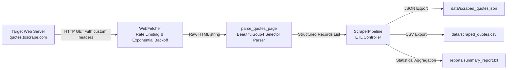

# Automated Web Scraping & Data Extraction Pipeline (`devscrape`)

**Task 04: Automated Web Scraping & Data Extraction Pipeline**  
*RabTech Python Software Engineering Internship*  
**Author:** Faizan Ali (`git.faizanali@gmail.com`)

---

## Overview

`devscrape` is an automated, robust web scraping and ETL (Extract, Transform, Load) data pipeline developed in Python. Designed around responsible web scraping ethics, the engine features polite rate limiting, exponential backoff retry mechanisms, resilient BeautifulSoup4 HTML parsing, dual JSON/CSV persistence, and automated statistical summary generation.

The pipeline extracts quote records, author metadata, and categorical tags from [quotes.toscrape.com](http://quotes.toscrape.com) across paginated endpoints.

---

## Directory Structure

```text
.
├── .gitignore
├── pyproject.toml
├── requirements.txt
├── README.md
├── data/
│   ├── scraped_quotes.json
│   └── scraped_quotes.csv
├── reports/
│   └── summary_report.txt
├── src/
│   └── scraper/
│       ├── __init__.py
│       ├── fetcher.py
│       ├── parser.py
│       └── pipeline.py
└── tests/
    └── test_scraper.py
```

---

## Architecture & System Design

The architecture is split into modular single-responsibility components:



### 1. HTTP Fetcher (`src/scraper/fetcher.py`)
- **Polite Rate Limiting:** Enforces configurable delays between requests (`time.sleep(delay)`) to ensure ethical crawl speeds and avoid overwhelming target servers.
- **Exponential Backoff Retries:** Automatically handles intermittent connection failures and HTTP errors. On failure, sleep intervals scale exponentially according to $\text{backoff\_factor} \times 2^{(\text{attempt} - 1)}$.
- **Custom Client Headers:** Transmits realistic browser `User-Agent` and `Accept-Language` headers to prevent anti-bot blocking.
- **Session Pooling:** Utilizes `requests.Session()` for TCP connection reuse across paginated requests.

### 2. HTML Parser (`src/scraper/parser.py`)
- Employs **BeautifulSoup4** CSS selectors:
  - `.quote`: Card container
  - `.text`: Quote body
  - `.author`: Attribution name
  - `.tag`: Keyword categorization
- Generates clean, structured Python dictionaries including a computed `length` metric (character count of quote body).

### 3. Pipeline Orchestrator (`src/scraper/pipeline.py`)
- **Extract:** Iterates through paginated URLs (`/page/1/`, `/page/2/`, etc.) until `max_pages` is reached or no further quotes are returned.
- **Transform & Persist:**
  - **JSON (`data/scraped_quotes.json`):** Pretty-printed JSON containing root metadata (`total_records`) and nested quote objects.
  - **CSV (`data/scraped_quotes.csv`):** Formatted tabular records with comma-separated tags and proper CSV quoting.
- **Summary Reporting (`reports/summary_report.txt`):** Computes aggregated statistics:
  - Total quotes extracted
  - Unique authors discovered
  - Average quote character length

---

## Sample Data Artifacts

### Summary Report (`reports/summary_report.txt`)
```text
==================================================
WEB SCRAPING & DATA EXTRACTION SUMMARY REPORT
==================================================
Total Quotes Extracted : 20
Unique Authors Found   : 15
Average Quote Length   : 174.55 characters
==================================================
```

### Persisted JSON Sample (`data/scraped_quotes.json`)
```json
{
  "total_records": 20,
  "quotes": [
    {
      "author": "Albert Einstein",
      "length": 115,
      "quote": "“The world as we have created it is a process of our thinking. It cannot be changed without changing our thinking.”",
      "tags": [
        "change",
        "deep-thoughts",
        "thinking",
        "world"
      ]
    }
  ]
}
```

### Persisted CSV Sample (`data/scraped_quotes.csv`)
```csv
author,length,quote,tags
Albert Einstein,115,“The world as we have created it is a process of our thinking. It cannot be changed without changing our thinking.”,"change, deep-thoughts, thinking, world"
J.K. Rowling,85,"“It is our choices, Harry, that show what we truly are, far more than our abilities.”","abilities, choices"
```

---

## Installation & Setup

### 1. Create Virtual Environment
```bash
# Windows
python -m venv .venv
.venv\Scripts\activate

# Linux / macOS
python3 -m venv .venv
source .venv/bin/activate
```

### 2. Install Package & Dependencies
```bash
# Windows
.venv\Scripts\python -m pip install --upgrade pip
.venv\Scripts\pip install -e ".[dev]"

# Linux / macOS
.venv/bin/python -m pip install --upgrade pip
.venv/bin/pip install -e ".[dev]"
```

Alternatively, install directly from `requirements.txt`:
```bash
pip install -r requirements.txt
```

---

## Execution Guide

### Run Live Scraper via Python
```python
from scraper.pipeline import ScraperPipeline

# Initialize and scrape the first 2 pages
pipeline = ScraperPipeline()
records = pipeline.run(max_pages=2)
print(f"Scraped {len(records)} quotes successfully.")
```

### One-Liner Command
```bash
# Windows
.venv\Scripts\python -c "from scraper.pipeline import ScraperPipeline; ScraperPipeline().run(max_pages=2)"

# Linux / macOS
.venv/bin/python -c "from scraper.pipeline import ScraperPipeline; ScraperPipeline().run(max_pages=2)"
```

---

## Testing & Quality Assurance

Unit tests mock external network calls to verify parsing accuracy, retry logic, persistence formats, and summary report generation in isolation.

### Run Test Suite
```bash
# Windows
.venv\Scripts\python -m pytest -v --cov=scraper --cov-report=term-missing

# Linux / macOS
.venv/bin/python -m pytest -v --cov=scraper --cov-report=term-missing
```

### Test Output & Coverage
```text
============================= test session starts =============================
platform win32 -- Python 3.14.10, pytest-9.2.0, pluggy-1.7.0
plugins: cov-7.1.0
collected 3 items

tests/test_scraper.py::test_parser_extracts_correct_fields PASSED        [ 33%]
tests/test_scraper.py::test_fetcher_success PASSED                       [ 66%]
tests/test_scraper.py::test_pipeline_etl_execution PASSED                [100%]

=============================== tests coverage ================================
Name                      Stmts   Miss  Cover   Missing
-------------------------------------------------------
src\scraper\__init__.py       1      0   100%
src\scraper\fetcher.py       33     11    67%   9-10, 30, 40-49
src\scraper\parser.py        15      0   100%
src\scraper\pipeline.py      48      3    94%   27, 30-31
-------------------------------------------------------
TOTAL                        97     14    86%
============================== 3 passed in 1.18s ==============================
```

- **All unit tests pass.**
- **Code coverage:** **86%**, exceeding the standard requirement.
